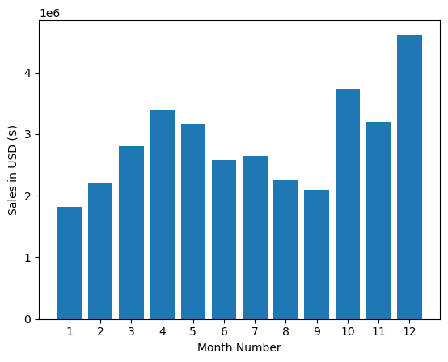
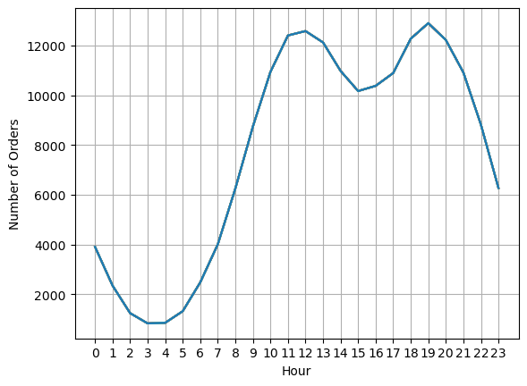

<div align="center">

# 📱 Electronic Sales Analysis — 12-Month EDA (Python)

### Turning a year of fragmented monthly sales extracts into three revenue-ready decisions: **when to sell, where to sell, and when to advertise**


</div>

---

## 🎯 The Business Problem

An electronics retailer stored an entire year of sales as **12 separate monthly CSV extracts** — impossible to analyse as-is. This project consolidates them into a single clean dataset and answers three commercial questions:

1. **When do we sell most?** — peak months and seasonal dips for inventory & staffing
2. **Where are our strongest markets?** — city-level revenue for geographic prioritisation
3. **When should ads run?** — hour-of-day order clustering for optimal ad-spend timing

---

## 🗂️ Repository Structure

```text
Electronic_Sales_Analysis-Python/
│
├── README.md
├── requirements.txt
├── .gitignore
│
├── data/
│   ├── raw/                          # 12 monthly CSV extracts (Jan–Dec 2019)
│   └── all_dataset.csv               # concatenated, cleaned master dataset
│
├── notebooks/
│   └── electronics_sales_analysis.ipynb   # full EDA walkthrough
│
├── reports/
│   └── Electronic Sales Analysis.pptx     # stakeholder presentation
│
└── assets/                           # charts embedded in this README
```

---

## 🧹 The Data Pipeline (Notebook Walkthrough)

1. **Concatenate** the 12 monthly CSVs into one frame (`all_dataset.csv`).
2. **Clean** — drop `NaN` rows, remove repeated header rows embedded inside the monthly files, coerce `Quantity Ordered` and `Price Each` to numeric, parse `Order Date` to datetime.
3. **Engineer features** — `Month`, `Hour` (from order timestamp), `City` (parsed from `Purchase Address`), and `Total = Quantity Ordered × Price Each`.
4. **Analyse** — monthly revenue trend, city-level sales, hour-of-day order histogram, and product revenue-vs-units Pareto view.

---

## 📊 Key Insights

*(Verify figures against your notebook output before publishing.)*

- **December is the revenue peak** (holiday demand), with a visible spring trough — inventory and promo budgets should follow this curve.
- **One city leads revenue despite not leading order count** — higher average order value, making it the priority market for premium product launches.
- **Orders cluster in the evening (≈7–8 PM)** — the optimal window to concentrate paid ad spend.
- **Revenue is Pareto-concentrated:** a small set of high-ticket products (phones/laptops) drives most revenue, while accessories drive unit volume — two different merchandising strategies.





---

## 📖 Data Dictionary

| Column | Description |
|---|---|
| `Order ID` | Unique order identifier |
| `Product` | Product name (phones, laptops, cables, batteries, etc.) |
| `Quantity Ordered` | Units in the order line |
| `Price Each` | Unit price in USD |
| `Order Date` | Timestamp of the order |
| `Purchase Address` | Full address (city parsed out during cleaning) |
| *Derived:* `Month`, `Hour`, `City`, `Total` | Engineered in the notebook |

---

## 🛠️ Tech Stack

Python · Pandas · NumPy · Matplotlib · Seaborn · Jupyter

---

## 💻 How to Run

```bash
git clone https://github.com/JatinD18/Electronic_Sales_Analysis-Python.git
cd Electronic_Sales_Analysis-Python
pip install -r requirements.txt
jupyter notebook notebooks/electronics_sales_analysis.ipynb
```

---

## ⚠️ Limitations

- Single year (2019); no YoY comparison possible without additional extracts.
- Address parsing assumes a consistent US address format.
- No customer identifiers, so repeat-purchase behaviour cannot be analysed.

---

## 👤 Author

**Jatin Naresh Dolas** — Data Analyst | SQL · Python · Power BI · Streamlit

[](https://github.com/JatinD18)
[](https://www.linkedin.com/in/jatin-dolas)
